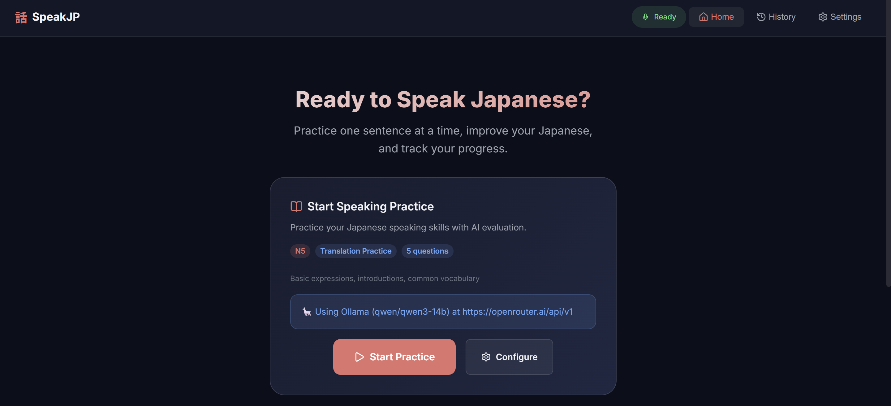

# 🇯🇵 Speak Japanese Sentence

> **AI-Powered Japanese Speaking Practice Web App**  
> Practice speaking Japanese one sentence at a time, receive instant AI evaluation and actionable feedback, and track your learning progress.

---

## 🖼️ Preview



---

## ✨ Features

- **🎙️ Voice Speech Recognition (ja-JP)**: Practice speaking naturally using your microphone via the browser Web Speech API (`ja-JP`), with a manual text input fallback when a microphone is unavailable.
- **🤖 Multi-Provider AI Evaluation**:
  - **Ollama**: Supports local instances (`http://localhost:11434/v1`), local LAN IPs, or remote URLs (`https://example.com/api/v1`), featuring an automatic **Fetch Models** button to discover installed models and optional Bearer auth tokens.
  - **Google Gemini**: Support for `gemini-2.0-flash`, `gemini-2.5-flash`, and `gemini-2.5-pro`.
  - **OpenAI**: Support for `gpt-4o-mini`, `gpt-4o`, `gpt-4.1-mini`, etc.
  - **Anthropic Claude**: Support for Claude 3.5 / 4 Sonnet and Haiku models.
- **🎯 3 Exercise Modes**:
  - **Translation**: Translate target sentences from Indonesian or English into natural Japanese.
  - **Scenario / Prompt Response**: Respond to contextual daily conversational situations.
  - **Free Speaking**: Answer open-ended Japanese conversation prompts.
- **📊 JLPT Levels (N5 - N1)**: Configurable difficulty tailored to vocabulary and grammar standards from beginner (N5) to advanced (N1).
- **💡 Real-Time AI Feedback & Hints**:
  - Instant sentence correctness evaluation.
  - In-depth **Grammar Notes** and **Vocabulary Notes**.
  - Adaptive **Hints** if your response needs refinement.
- **🔁 Retry Flow & Auto-Advance**: Configurable maximum attempts per question and optional auto-advance upon correct answers.
- **📈 Session Recap & History**:
  - Comprehensive performance summary: accuracy percentage, elapsed time, and per-question reviews with recorded transcripts.
  - Complete session history stored locally in your browser (*LocalStorage*).
- **🌐 Bilingual UI & Instructions**: Full interface and instructional prompt support in both **English** and **Indonesian**.

---

## 📁 Project Structure

```text
Speak-Japanese-Sentence/
├── public/                        # Static public assets
├── src/
│   ├── assets/                    # Media & styling assets
│   ├── components/
│   │   └── Header.tsx             # Navigation header & microphone permission status
│   ├── hooks/
│   │   └── useSession.ts          # State machine for practice sessions, AI evaluation, and timer
│   ├── pages/
│   │   ├── HomePage.tsx           # Dashboard & quick practice session launcher
│   │   ├── PracticePage.tsx       # Core gameplay (speech recognition, feedback, retry flow)
│   │   ├── RecapPage.tsx          # Practice session performance summary
│   │   ├── HistoryPage.tsx        # Past session logs and statistics
│   │   └── SettingsPage.tsx       # AI Provider, Model, URL, and practice options
│   ├── services/
│   │   ├── ai.ts                  # AI API integrations (Ollama, Gemini, OpenAI, Claude) & model fetching
│   │   ├── speech.ts              # Web Speech API wrapper (SpeechRecognition & SpeechSynthesis)
│   │   └── storage.ts             # LocalStorage abstraction for settings & session history
│   ├── types/
│   │   └── index.ts               # Domain types, interfaces, and JLPT/mode constants
│   ├── App.tsx                    # Root component & route definitions
│   ├── index.css                  # Design system (Dark-theme UI, CSS tokens, micro-animations)
│   └── main.tsx                   # Application entry point
├── index.html                     # HTML5 template
├── package.json                   # Project metadata & dependencies
├── tsconfig.json                  # TypeScript compiler configuration
├── vite.config.ts                 # Vite configuration & dev-server proxy for Ollama CORS
└── README.md                      # Project documentation
```

---

## 🛠️ Tech Stack

- **Frontend Core**: [React 19](https://react.dev/) + [TypeScript](https://www.typescriptlang.org/)
- **Bundler & Build Tool**: [Vite 8](https://vite.dev/)
- **Routing**: [React Router DOM v7](https://reactrouter.com/)
- **Icons**: [Lucide React](https://lucide.dev/)
- **Speech Technologies**:
  - Web Speech API (`webkitSpeechRecognition` / `SpeechRecognition`)
  - Web Speech Synthesis API (`speechSynthesis`)
- **Styling**: Pure Modern CSS (CSS Custom Properties, Flexbox/Grid, Glassmorphism, Responsive & Dark Theme)
- **Data Persistence**: Browser LocalStorage API

---

## 🚀 How to Run Locally

### 1. Prerequisites

Make sure you have installed:
- [Node.js](https://nodejs.org/) (version 18 or later)
- Package Manager (`npm`, `pnpm`, or `yarn`)
- *(Optional)* [Ollama](https://ollama.ai/) if you wish to run free local LLMs without external API keys.

### 2. Clone & Install Dependencies

```bash
# Clone this repository
git clone https://github.com/IlkhamAbdillah/Speak-Japanese-Sentence.git

# Navigate to the project directory
cd Speak-Japanese-Sentence

# Install dependencies
npm install
```

### 3. Run Development Server

```bash
npm run dev
```

Open your browser and navigate to `http://localhost:5173`.

### 4. Configure AI Provider (Settings Page)

1. Open the **⚙️ Settings** page in the application.
2. Select your preferred AI Provider:
   - **Ollama**:
     - Enter your Ollama URL (default: `http://localhost:11434/v1` or your custom remote URL).
     - Click **Fetch Models** to automatically load all models available on your instance (e.g., `llama3.1`, `qwen2.5`, `mistral`).
     - Enter an Auth Token if your tunnel/proxy is secured with Bearer authentication.
   - **Google Gemini / OpenAI / Anthropic Claude**:
     - Enter your API key and choose your desired model.
3. Click **Test Connection** to verify connectivity.
4. Click **Save Settings** — you will be redirected to the home page ready to practice!

### 5. Build for Production

```bash
# Build production bundle
npm run build

# Preview production build locally
npm run preview
```
