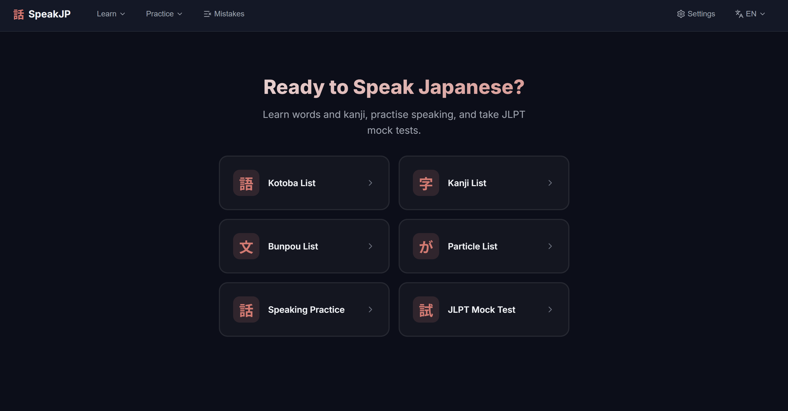

# 話 SpeakJP

**Learn Japanese words, kanji and grammar, then practise them out loud.**

SpeakJP is a browser-only Japanese study app. You answer in Japanese by **speaking**
(Web Speech API, `ja-JP`) or **typing**. An AI of your choice writes the exercises and
grades the free answers, and everything else (word lists, quizzes, progress) works
locally in the browser. There is no backend and no account: settings, progress and
history stay in your browser's `localStorage`.

The interface is available in **English** and **Indonesian**.



---

## Contents

- [Features](#features)
- [AI providers](#ai-providers)
- [Getting started](#getting-started)
- [Deployment](#deployment)
- [Project structure](#project-structure)
- [Data and credits](#data-and-credits)
- [Privacy](#privacy)
- [Browser support](#browser-support)

---

## Features

The header groups the app into **Learn** (the reference lists) and **Practice** (AI
sessions), plus **Mistakes** and **Settings**. On phones everything sits behind the ☰
menu.

### Learn

| Section | What's in it | Quiz / practice |
|---|---|---|
| **語 Kotoba List** (`/words`) | Verbs, adjectives, adverbs, conjunctions and onomatopoeia, by JLPT level (N5 → N1 → Non-JLPT), with how common each word is, its verb group or い/な type, and audio | Quiz: word → meaning, meaning → word, or say/type the word. No AI needed |
| **字 Kanji List** (`/kanji`) | Every JLPT kanji as a tile grid, with meanings, on'yomi / kun'yomi, example words, and a radical / parts filter (聞 is listed under 耳 and 門) | **Practice readings**: say or type the kanji's reading in 5 real words. Progress is tracked with spaced reviews (new → learning → mastered). Quiz: readings or look-alike kanji (時 / 持 / 待 / 特) |
| **文 Bunpou List** (`/grammar`) | 415 grammar points, N5 → N1, each with its meaning, how it attaches (V-dict + ことができる) and example sentences | **Practice this grammar** (AI): 5 sentences in your language to say or type in Japanese with that grammar point, graded by the AI. Progress is tracked like kanji. Quiz: fill the blank / meaning → pattern |
| **が Particle List** (`/particles`) | 53 uses of 24 particles (に for time, place, a person…) with examples | Quiz: fill the particles into sentences from a keypad or by typing romaji. Sentences are new from the AI or taken from the list. **Mine works too?** asks the AI whether your other particle also fits |

All lists can be searched in kana, kanji, romaji (`tabemasu`, `tame ni`) or by meaning.

### Practice (AI)

| Mode | How it works |
|---|---|
| **Speaking Practice: Translation** | Translate a story sentence by sentence (pick its topic, tense and length), or quick unrelated sentences |
| **Speaking Practice: Situation** | Say what you would say in an everyday situation |
| **Speaking Practice: Conversation** | Free chat in a messaging-app layout. Each reply comes with a translation and a correction of your message |
| **JLPT Mock Test: Kanji** | The app picks the target kanji of your level and the AI writes a word for each. You say or type the reading, and it is checked locally |
| **JLPT Mock Test: Reading** | A reading passage with 3 multiple-choice questions in the style of the real test |

Each session can set the JLPT level (N5–N1), the number of questions, the attempts per
question (1 = exam style) and hints. The AI answers with a verdict (natural / slightly
unnatural / grammar errors / partial / incorrect), short feedback, a nudge before the
answer is shown, and after it a corrected version of your sentence and other ways to
say it.

### Also

- **Voice input**: on laptops, click the mic and the answer is sent after 3 s of
  silence (single words are sent right away). On phones, hold the mic to talk and
  slide away to cancel.
- **Mistakes** (`/mistakes`): every question whose latest answer was wrong, grouped by
  mode, with *Practice* to redo them. A question leaves the list once you get it right.
- **Recap and Retry wrong answers** after every session.
- **Continue last session**: closing the tab or reloading keeps the session. Home and
  the mode page offer to continue it or discard it.
- **Keyboard friendly**: Enter submits, 1–4 picks a choice, R tries again, Esc asks
  before ending a session, ←/→ steps through cards.

---

## AI providers

Choose the AI in **⚙ Settings**. The API key is stored only in your browser and is sent
directly from your browser to the provider.

| Provider | What you need |
|---|---|
| **Google Gemini** (default) | An API key from Google AI Studio |
| **OpenAI** | An OpenAI API key |
| **Anthropic Claude** | An Anthropic API key (the app uses direct browser access) |
| **Custom URL** | Any **OpenAI-compatible** server: a model running on your computer (e.g. `http://localhost:11434/v1`) or a remote URL (`https://example.com/api/v1`). The `/v1/chat/completions` suffix is added automatically. **Fetch Models** lists the server's models, and a Bearer token is optional |

**Test Connection** checks the settings, and **Remove AI Settings** clears the provider,
key and URL. When no AI is set up, the AI features say so and link to Settings. When a
request fails, the error shows a Settings button.

The Words, Kanji and Particle-list quizzes, the kanji reading practice and the JLPT
kanji answer check work **without** an AI.

---

## Getting started

### Requirements

- [Node.js](https://nodejs.org/) 20.19 or later (required by Vite 8), and npm
- Chrome or Edge for voice input (see [Browser support](#browser-support))
- An AI provider key, or an OpenAI-compatible server for the AI features

### Install and run

```bash
git clone https://github.com/IlkhamAbdillah/Speak-Japanese-Sentence.git
cd Speak-Japanese-Sentence
npm install
npm run dev
```

Open <http://localhost:5173>, go to **⚙ Settings**, pick a provider, enter the key (or
the URL), press **Test Connection** and then **Save Changes**.

> **Local model on `localhost:11434`?** The dev server proxies `/ollama-api` to
> `http://localhost:11434` (see `vite.config.ts`), which avoids CORS problems while
> developing.

### Scripts

| Command | What it does |
|---|---|
| `npm run dev` | Vite dev server with hot reload |
| `npm run build` | Type-check (`tsc -b`) and build into `dist/` |
| `npm run preview` | Serve the production build locally |
| `npm run lint` | Lint with oxlint |

---

## Deployment

The app is a static site and is deployed on **Vercel**. `vercel.json` rewrites every
path to `/index.html`, so refreshing on `/kanji` or `/recap/…` works with the
client-side router. Any static host with an SPA fallback works the same way: build with
`npm run build` and serve `dist/`.

---

## Project structure

```text
src/
├── App.tsx                 Routes, the active practice session, Continue / Retry flows
├── navigation.ts           Header groups and Home cards (Learn / Practice)
├── index.css               Plain CSS with design tokens (dark theme only)
├── i18n/                   Translations: locales/en.json, locales/id.json (type-checked keys)
├── types/index.ts          Domain types, settings, mode helpers, AI model lists
├── pages/                  One file per route (Home, Words, Kanji, Grammar, Particles,
│                           Mode, Practice, Conversation, Recap, Mistakes, Settings)
├── components/             Dialogs, quizzes, cards, the header…
├── hooks/                  useSession (practice state machine), useConversation,
│                           usePushToTalk, useEscapeKey
├── services/
│   ├── ai.ts               One client for OpenAI, Gemini, Claude and Custom URL; prompts,
│   │                       question generation and answer evaluation
│   ├── grammarPractice.ts  Grammar practice: AI exercises and grading
│   ├── particleAI.ts       Particle sentences and "Mine works too?" from the AI
│   ├── speech.ts           Web Speech API: recognition (ja-JP) and speech synthesis
│   ├── storage.ts          localStorage: settings (with migrations), sessions, progress
│   ├── review.ts           Spaced review shared by the kanji and grammar progress
│   ├── romaji.ts           Kana ↔ romaji for search
│   └── …                   Kanji, vocab, grammar and particle list logic
└── data/
    ├── vocab/              Word lists (words.json, verbs.json)
    ├── kanji/              JLPT kanji, KANJIDIC details, practice words, look-alikes
    └── grammar/            Grammar points (n5.txt … n1.txt) and particles.txt
```

Each `src/data/*` folder has its own `README.md` describing the format and how the data
was made.

### Adding a language

Copy `src/i18n/locales/en.json` to `<code>.json`, translate it, and add it to
`LANGUAGES` in `src/i18n/index.ts`. A missing key fails the type-check, so no string can
be forgotten. AI prompts use the locale's `meta.promptName`, so feedback comes in that
language too.

---

## Data and credits

| Data | Source | License |
|---|---|---|
| JLPT kanji levels | Jonathan Waller's JLPT lists, [tanos.co.uk](http://www.tanos.co.uk/jlpt/) | CC BY |
| Kanji meanings, readings, frequency | [KANJIDIC](http://www.edrdg.org/wiki/index.php/KANJIDIC_Project) (EDRDG), via [kanji-data](https://github.com/davidluzgouveia/kanji-data) | CC BY-SA 4.0 |
| Kanji parts | [KRADFILE](https://www.edrdg.org/krad/kradinf.html) (EDRDG) | CC BY-SA 4.0 |
| Larger kanji parts | [KanjiVG](https://kanjivg.tagaini.net) (Ulrich Apel) | CC BY-SA 3.0 |
| Look-alike kanji | Lars Yencken's kanji similarity data | CC BY 3.0 |
| JLPT vocabulary levels | [open-anki-jlpt-decks](https://github.com/jamsinclair/open-anki-jlpt-decks) (based on the Waller lists) | MIT |
| Word classes | [JMdict](https://www.edrdg.org/wiki/index.php/JMdict-EDICT_Dictionary_Project) (EDRDG), via jmdict-simplified | CC BY-SA 4.0 |
| Word frequency | [wordfreq](https://github.com/rspeer/wordfreq) | CC BY-SA 4.0 (data) |
| Verb list | [Japanese Verb Conjugator](https://www.japaneseverbconjugator.com/JVerbList.asp) | — |
| Adjectives | Picked for the app, plus [JLPT Sensei](https://jlptsensei.com) adjective lists | — |
| Onomatopoeia, adverbs, conjunctions | *kotoba onomatope* PDF ([Scribd](https://www.scribd.com/document/485472399/kotoba-onomatope)) | — |
| Grammar points, particles, example sentences | Written for this app | — |

The JLPT publishes no official kanji, vocabulary or grammar lists, so all levels follow
the commonly used unofficial lists. Some items may sit one level higher or lower
elsewhere.

---

## Privacy

- No server and no analytics. Everything is stored in your browser's `localStorage`
  (`sjp_settings`, `sjp_sessions`, `sjp_kanji_progress`, `sjp_grammar_progress`, …).
- Your API key goes only to the provider you chose.
- Speech recognition is done by the browser. Chrome sends the audio to Google's speech
  service.
- What you say or type is sent to your AI provider only for the AI features, and it is
  marked as untrusted input in the prompts.

---

## Browser support

| | Voice input | Everything else |
|---|---|---|
| Chrome / Edge (desktop and Android) | ✅ | ✅ |
| Safari (macOS / iOS) | Partial (Web Speech support varies) | ✅ |
| Firefox | ❌ (no Web Speech recognition), use typing | ✅ |

Allow microphone access when the browser asks. Typing always works as a fallback.
