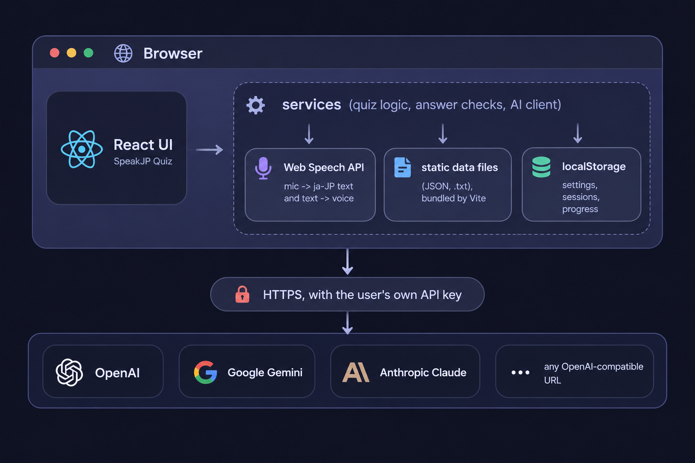

# Cara kerja SpeakJP

Halaman ini menjelaskan bagaimana SpeakJP dibuat: bahasa pemrograman dan library yang
dipakai, tempat data disimpan, cara aplikasi berkomunikasi dengan AI, cara kerja input
suara, dan algoritma kecil di balik kuis dan progres. Halaman ini ditulis untuk developer
dan pengguna yang penasaran. Halaman ini tidak ditautkan dari menu; buka lewat `/docs`.

## Gambaran umum

SpeakJP adalah **aplikasi web satu halaman (SPA) yang berjalan sepenuhnya di browser**.
Tidak ada server sendiri, tidak ada server database, dan tidak ada sistem akun.

- **Daftar referensi** (kosakata, kanji, tata bahasa, partikel) adalah file data statis
  yang dibundel bersama aplikasi.
- **Kuis dan pengecekan yang tidak butuh penilaian** (memilih jawaban, bacaan kanji,
  partikel) berjalan secara lokal di JavaScript.
- **Jawaban bebas dan latihan baru** dikirim ke penyedia AI yang dipilih pengguna.
  Browser memanggil penyedia itu langsung dengan API key milik pengguna sendiri.
- **Semua yang dibuat pengguna** (pengaturan, riwayat, progres) disimpan di
  `localStorage` browser.



## Teknologi

| Lapisan | Pilihan | Alasan |
|---|---|---|
| Bahasa | **TypeScript** (strict) | Tipe untuk pengaturan, sesi, dan balasan AI; kunci terjemahan juga dicek tipenya |
| UI | **React 19** | Function component dan hook; tanpa library state, state disimpan di hook lalu diteruskan ke bawah |
| Build | **Vite 8** | Dev server cepat; impor `?raw` untuk file teks tata bahasa; code splitting untuk halaman yang berat |
| Routing | **React Router 7** (`BrowserRouter`) | URL asli (`/kanji`, `/recap/<id>`); Vercel mengarahkan semua path ke `index.html` |
| Ikon | **lucide-react** | |
| Styling | **CSS biasa** dengan design token (`--space-*`, `--accent-primary`…) dalam satu `index.css` | Hanya tema gelap; tanpa framework CSS |
| Suara | **Web Speech API**: `SpeechRecognition` (`ja-JP`) dan `speechSynthesis` | Sudah ada di Chrome / Edge, tanpa layanan tambahan yang berbayar |
| Lint | **oxlint** | |
| Hosting | **Vercel** (statis) | |

Halaman yang berat **dimuat belakangan (lazy-load)** dengan `React.lazy`, jadi datanya
tidak ikut di unduhan pertama: halaman Kanji (dengan `details.json` dan kata latihan),
halaman Tata Bahasa, dan halaman Partikel. Halaman ini juga dimuat belakangan.

## Struktur kode

```text
src/
├── App.tsx            route, sesi latihan yang sedang berjalan, alur Lanjutkan / Ulangi
├── navigation.ts      grup menu header dan kartu Beranda
├── pages/             satu komponen per route
├── components/        dialog, kuis, kartu, header
├── hooks/             useSession, useConversation, usePushToTalk, useEscapeKey
├── services/          logika tanpa UI: klien AI, suara, penyimpanan, pembuat kuis
├── i18n/              terjemahan (en, id) dan hook useI18n
├── types/             tipe bersama, pengaturan default, helper mode
└── data/              daftar statis (kosakata, kanji, tata bahasa)
```

Aturan dasarnya: **halaman dan komponen hanya menampilkan dan menangani input; logika ada
di `services/`.** Service berupa fungsi biasa yang mengolah data biasa, jadi tidak
bergantung pada React.

## Penyimpanan data

Tidak ada server database. "Database"-nya adalah **`localStorage`** milik browser, yaitu
penyimpanan key–value kecil per situs dan per browser. Setiap nilai berupa string JSON.

| Key | Isi |
|---|---|
| `sjp_settings` | `UserSettings`: penyedia / model / key / URL AI, bahasa antarmuka, mode, dan opsi setiap daftar dan kuis |
| `sjp_sessions` | Setiap sesi latihan yang selesai, terbaru di depan: soal, setiap percobaan (transkrip, penilaian AI, waktu), dan hasilnya |
| `sjp_active_session` | Sesi yang sedang berjalan, supaya bisa **Dilanjutkan** setelah halaman dimuat ulang atau tab ditutup |
| `sjp_kanji_progress` | Per kanji: streak, waktu review berikutnya, kata yang sudah dilatih |
| `sjp_grammar_progress` | Per pola tata bahasa (`level:pola`): streak dan waktu review berikutnya |
| `sjp_dismissed_mistakes` | Kesalahan yang dihapus pengguna dari halaman Kesalahan |
| `sjp_schema_version` | Versi format penyimpanan |

Semua akses lewat `services/storage.ts`:

- **Baca dan tulis yang aman.** `safeGet` / `safeSet` menangkap error: mode private,
  penyimpanan yang diblokir, dan kuota penuh tidak membuat aplikasi crash.
- **Migrasi saat dimuat.** `loadSettings()` menggabungkan pengaturan tersimpan dengan
  nilai default dan memperbaiki nilai lama: mode yang sudah dihapus diganti dengan
  penggantinya, model yang sudah tidak ditawarkan diganti dengan model pertama penyedia
  itu, bahasa yang tidak dikenal kembali ke default, dan opsi daftar yang tidak valid
  dibuang.
- **Penyimpanan penuh.** Jika `sjp_sessions` sudah tidak muat, `saveSession` membuang 10%
  sesi tertua lalu mencoba lagi, jadi sesi baru selalu tersimpan.
- **Tidak ada yang keluar dari perangkat**, kecuali yang dikirim ke penyedia AI pilihan.

### Data statis

Daftar-daftarnya adalah file di `src/data/` yang dibundel Vite saat build:

| Folder | File | Format |
|---|---|---|
| `vocab/` | `words.json`, `verbs.json` | JSON; setiap kata punya kana, kanji, arti (en, id), level JLPT, tingkat keseringan, topik |
| `kanji/` | `jlpt.json`, `details.json`, `words.json`, `similar.json` | JSON; kanji per level, arti dan bacaan dari KANJIDIC, bagian kanji, kata latihan beserta frekuensinya, kanji yang mirip |
| `grammar/` | `n5.txt` … `n1.txt`, `particles.txt` | Format baris sederhana, diurai saat dimuat |

Format tata bahasa, satu blok per pola:

```text
@ 〜ことができる
= can, be able to | bisa, dapat
f V-dict + ことができる
s decide
e 私はピアノを弾く[ことができます]。 | I can play the piano. | Saya bisa bermain piano.
```

`@` adalah polanya, `=` artinya (Inggris | Indonesia), `f` cara menyambungnya, `s` grup
pola yang mudah tertukar, dan `e` contoh kalimat dengan bagian tata bahasanya di dalam
`[ ]`. Tanda kurung itu menandai bagian yang disorot di kartu dan dikosongkan di kuis.

Setiap folder data punya `README.md` berisi sumber, lisensi, dan cara data itu dibuat.

## Lapisan AI

`services/ai.ts` berisi satu klien kecil, `callProvider`, untuk empat jenis penyedia:

| Penyedia | Endpoint | Catatan |
|---|---|---|
| OpenAI | `/v1/chat/completions` | `max_completion_tokens`, tanpa temperature (model memakai nilai default-nya) |
| Google Gemini | `generateContent` | bagian teks balasan digabung (bagian "thought" dilewati) |
| Anthropic Claude | `/v1/messages` | header `anthropic-dangerous-direct-browser-access` mengizinkan panggilan dari browser; blok thinking dilewati |
| URL Kustom | `/v1/chat/completions` mana pun yang kompatibel dengan OpenAI | akhiran URL ditambahkan otomatis; token Bearer opsional |

Setiap permintaan mengizinkan sampai **16 000 token output**, karena model sekarang
memakai sebagian anggarannya untuk berpikir dan tes membaca cukup panjang.

### Meminta JSON dengan aman

Setiap prompt meminta **hanya JSON**, dengan bentuk tertentu. Model tetap sering
menambahkan teks di sekitarnya, jadi balasan tidak pernah langsung diberikan ke
`JSON.parse`:

1. `extractJSON` mengambil isi blok kode Markdown jika model menulisnya.
2. Lalu fungsi itu mencari **nilai JSON seimbang yang pertama**: teks ditelusuri sambil
   menghitung `[`/`{` terhadap `]`/`}`, dan tanda kurung di dalam string dilewati. Teks di
   depan dan di belakangnya diabaikan. Balasan yang terpotong di tengah menghasilkan error
   "incomplete JSON" yang jelas.
3. Setiap item kemudian **divalidasi oleh aplikasi**, dan item yang melanggar aturan
   dibuang. Aplikasi tidak pernah mengandalkan AI untuk menaati aturan.

**Prompt injection.** Apa pun yang diucapkan atau diketik pengguna diberi label
**UNTRUSTED** di prompt, dengan instruksi untuk menilainya saja dan tidak pernah mengikuti
instruksi di dalamnya.

### Untuk apa AI dipakai

| Fitur | Panggilan | Yang dicek atau dikerjakan aplikasi sendiri |
|---|---|---|
| Soal Terjemahan / Situasi | 1 per sesi | Mode cerita: cerita dipecah menjadi kalimat dan disimpan bersama sesi, jadi penilaian berikutnya punya konteksnya |
| Soal Kanji JLPT | 1 (+1 ulang) | **Aplikasi yang memilih kanji targetnya**; AI hanya menulis katanya. Setiap kata harus memuat kanji target, kanji lainnya harus di level itu atau lebih mudah, dan bacaannya harus hiragana. Target yang ditolak diminta sekali lagi, dan yang masih kosong dibuang |
| Tes Membaca JLPT | 1 | Aplikasi **mengacak 4 pilihan** (model cenderung menaruh jawaban di urutan pertama) dan mengecek pilihan secara lokal |
| Menilai kalimat yang diucapkan / diketik | 1 per jawaban | Penilaian (verdict) yang menentukan: `natural` dan `slightly_unnatural` dihitung benar. Jawaban yang dikoreksi hanya ditampilkan bersama jawaban yang dibuka, supaya tidak membocorkan jawaban sebelum mencoba lagi |
| Percakapan | 1 per pesan | Balasan disertai terjemahan dan koreksi pesan pengguna |
| Latihan tata bahasa | 1 untuk menulis 5 kalimat, lalu 1 per jawaban | Jawaban yang sama dengan kalimat yang diharapkan diterima **tanpa** panggilan AI |
| Kuis partikel | 1 per kuis; 1 untuk "Jawabanku juga benar?" | Bagian kosong harus partikel dari keypad; jawaban dicek secara lokal |

Bacaan kanji, pilihan ganda, partikel, dan latihan bacaan **tidak pernah** dikirim ke AI.
Mengeceknya di aplikasi lebih murah, lebih cepat, dan hasilnya selalu sama.

## Input suara

`services/speech.ts` membungkus `SpeechRecognition` milik browser dengan
`lang = 'ja-JP'` dan hasil sementara (interim) aktif.

- **Menggabungkan hasil.** Chrome bisa mengirim frasa yang sama dua kali, atau frasa yang
  makin panjang sebagai hasil terpisah. `mergeSegments` menggabungkannya dan membuang
  pengulangan.
- **Mulai ulang.** Browser mengakhiri sesi pengenalan suara sendiri setelah jeda (Chrome
  di Android setelah setiap frasa). Pembungkusnya memulai ulang dan menyimpan teks
  sebelumnya, jadi hanya aplikasi yang menentukan kapan jawaban selesai.
- **Kapan jawaban dianggap selesai**, tergantung apa yang dijawab:

| Jawaban | Laptop (klik mic) | HP (tekan dan tahan) |
|---|---|---|
| Kalimat | dikirim setelah **3 detik hening** | dikirim saat **dilepas** (menunggu sampai 1,5 detik untuk hasil terakhir) |
| Satu bacaan (kanji) | dikirim pada **hasil final pertama**, kecuali baru 「それは…」 yang diucapkan | dikirim saat dilepas |
| Pesan chat | tidak pernah terkirim sendiri; teksnya masuk ke kotak pesan | melepas mic menaruh teks di kotak pesan |

- **Tekan dan tahan** (`hooks/usePushToTalk.ts`) dipakai jika perangkat memakai pointer
  kasar (layar sentuh). Menggeser jari 80 px sebelum melepas akan membatalkan. Di HP mic
  tidak dimulai ulang setelah jeda, karena Android membunyikan suara mic setiap kali.
- **Membatalkan** dengan ■ membuang apa yang terdengar; tidak pernah mengirim jawaban.
- **Jawaban kanji** boleh diucapkan dalam kalimat: 「それは しょく です」. `stripKanjiTemplate`
  membuang frasa itu sebelum dicek.
- **Output suara** (tombol 🔊) memakai `speechSynthesis` dengan suara bahasa Jepang.

## Algoritma

### Normalisasi teks

Sebelum jawaban dibandingkan, kedua sisi diproses `normalizeReading`: Unicode NFKC
(lebar penuh ↔ lebar setengah), katakana → hiragana, serta spasi dan tanda baca dibuang.
Jadi `ショク`, `しょく`, dan `しょく。` dianggap sama.

### Review berjarak (progres kanji dan tata bahasa)

`services/review.ts`. Setiap latihan satu kanji atau satu pola tata bahasa menghasilkan
**satu hasil**:

1. **Latihan yang baik** = minimal **80% benar pada percobaan pertama** tanpa Lihat jawaban (4 dari 5).
2. Baik → `streak + 1`; tidak baik → `streak = 0`.
3. Review berikutnya jatuh tempo setelah jeda yang ditentukan oleh streak baru:

| Streak setelah latihan | 0 | 1 | 2 | 3 | 4 | 5+ |
|---|---|---|---|---|---|---|
| Review berikutnya dalam | 4 jam | 1 hari | 3 hari | 7 hari | 14 hari | 30 hari |

4. **Streak 3 = dikuasai.**
5. Latihan yang baik **sebelum jatuh tempo** tidak mengubah apa-apa: untuk menguasai
   dibutuhkan review berjarak, bukan tiga latihan dalam satu malam.
6. Ulangi yang salah dan berhenti di tengah jalan tidak dihitung.

Status di kartu: belum ada catatan = *baru*, streak 1–2 = *sedang dipelajari* (kuning),
3+ = *dikuasai* (hijau).

### Memilih kata latihan untuk sebuah kanji

`services/kanjiPractice.ts`. Untuk setiap kanji, aplikasi mencari semua kata JLPT yang
memuatnya, lalu menentukan **bagian mana dari bacaan kata itu yang milik kanji tersebut**
(`readingInWord`):

- Kun'yomi dengan okurigana dicoba lebih dulu karena paling spesifik (生きる vs 生まれる),
  lalu bacaan yang lebih panjang.
- Perubahan bunyi juga dicoba: rendaku (か → が), geminasi (がく → がっ di 学校), dan
  sebagainya.
- Jika bagian kanji itu tidak bisa ditemukan (今日 きょう: bacaan khusus), katanya tidak
  dipakai.

Lima kata kemudian diambil **secara acak, dengan bobot**:

```text
bobot(kata) = 3 ^ (zipf(kata) − zipf(kata paling umum))
            ÷ 4 ^ (kata yang sudah terpilih dengan bacaan yang sama)
```

`zipf` adalah frekuensi kata pada skala Zipf (dari wordfreq), di mana setiap langkah
berarti 10× lebih sering. Jadi kata yang 1 langkah lebih jarang punya peluang 3× lebih
kecil, dan bacaan yang sudah ditanyakan punya peluang 4× lebih kecil, sehingga on'yomi
dan kun'yomi tercampur. Kelima kata ditanyakan dalam urutan acak.

Jawaban dihitung benar jika cocok dengan bagian kanji itu (しょく), bacaan seperti yang
tercantum, akar kata dengan okurigana (たべる), atau seluruh kata. Jika diucapkan, kata itu
sendiri, kanji itu sendiri, atau kanji lain dengan bacaan yang sama juga dihitung benar,
karena pengenalan suara sering menuliskannya dengan kanji.

### Pilihan kanji yang mirip

`similar.json` mencantumkan, untuk setiap kanji, kanji-kanji yang mirip, dari yang paling
mirip (kemiripan goresan dari Yencken ditambah bagian kanji yang sama). Untuk satu soal,
aplikasi mengambil **3 secara acak dari 5 yang paling mirip**, jadi soalnya berubah dari
satu percobaan ke percobaan berikutnya. Aplikasi tidak pernah memakai kanji yang sudah ada
di kata itu, dan tidak pernah memakai tulisan yang ternyata kata sungguhan dengan bacaan
yang sama.

### Pilihan salah di kuis tata bahasa

Dua pola tata bahasa bisa sama-sama menjawab satu soal. Aplikasi tidak pernah menawarkan
keduanya bersamaan jika keduanya:

- punya arti bahasa Inggris yang sama (から / ので: keduanya "because");
- berada di grup `s` yang sama (ましょう / ませんか);
- sama-sama bagian kosong dua potong yang potongan awal atau akhirnya sama (は…です /
  は…にいます).

Pilihan salah diambil dari level JLPT yang sama, jadi tetap terlihat masuk akal.

### Pencarian romaji

`services/romaji.ts` mengubah kana menjadi romaji Hepburn. Kata dan kata kunci pencarian
lalu diproses `romajiKey`, yang menyamakan variasi ejaan yang umum:

- si → shi, ti → chi, tu → tsu, hu → fu, zi / di → ji
- m sebelum b / p / m → n (shimbun = shinbun)
- aksen dibuang (ō → o)

Kata kunci cocok **dari awal kata** (`tabe` → たべる), atau sebagai **seluruh kata dengan
vokal panjang disamakan** (`tokyo` = とうきょう, `okii` = おおきい). Vokal pendek tidak cocok
dengan vokal panjang sebagai awalan, jadi `mou` tidak menemukan もつ.

### Daftar kesalahan

`services/mistakes.ts` menyusun daftar dari sesi yang tersimpan, tanpa panggilan AI:

1. Urutkan sesi dari yang terlama.
2. Simpan hasil **terakhir** setiap soal (sesi ulangan memakai id soal yang sama, jadi
   jawaban benar yang belakangan menggantikan jawaban salah sebelumnya).
3. Ambil hanya yang salah dan belum dihapus, lalu kelompokkan per mode, atau per cerita
   untuk terjemahan cerita.

### Mengetik partikel

Di kuis partikel, bagian kosong bisa diisi dengan mengetik romaji. Huruf yang diketik
dicocokkan dengan partikel di keypad (`wa` → は, `o` → を, `e` → へ). Jika sebuah awalan
ambigu (`ka` bisa か atau から), tekan Spasi untuk menyelesaikannya.

## Terjemahan

- Setiap teks di layar ada di `src/i18n/locales/<kode>.json` (Inggris, Indonesia).
- Komponen memanggil `t('bagian.kunci', { nama })`; placeholder `{nama}` diisi otomatis.
- Kuncinya **dicek tipenya**: setiap bahasa harus punya semua kunci dari `en.json`, atau
  build gagal, jadi tidak ada terjemahan yang terlewat.
- AI diberi tahu nama bahasa antarmuka yang sedang dipakai, jadi masukan dan kalimat yang
  dibuat AI memakai bahasa pengguna.
- Halaman dokumentasi ini ditulis dalam bahasa Inggris dan Indonesia (`system.md`,
  `system.id.md`) dan mengikuti bahasa antarmuka.

## Catatan performa

- Grid kanji berisi sekitar 2 000 petak. Setiap petak memakai `content-visibility: auto`,
  jadi petak di luar layar tidak di-layout atau digambar, dan hanya file font Jepang untuk
  karakter yang terlihat yang diunduh.
- Hitungan yang seharusnya dihitung ulang di setiap render dikerjakan sekali saat modul
  dimuat.
- Filter yang berat hanya berjalan di tab yang membutuhkannya.

## Cara pengujian

Tidak ada unit test otomatis. Perubahan dicek dari ujung ke ujung (end to end):

1. Server Node kecil meniru endpoint `/v1/chat/completions` yang kompatibel dengan OpenAI
   dan mengembalikan JSON siap pakai berdasarkan teks di system prompt.
2. Pengaturan aplikasi di `localStorage` mengarahkan URL Kustom ke server itu.
3. Playwright menjalankan Chromium headless melalui alur-alurnya.
4. Suara dipalsukan dengan mengganti `SpeechRecognition` di halaman.

`npm run build` (cek tipe dan build) dan `npm run lint` harus lulus.
