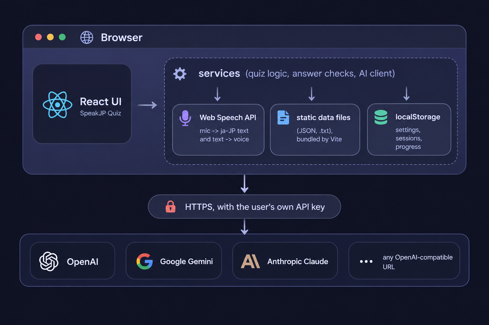

# How SpeakJP works

This page explains how SpeakJP is built: the languages and libraries, where the data
lives, how the app talks to the AI, how speech input works, and the small algorithms
behind the quizzes and the progress. It is written for developers and curious users. It
is not linked from the menus; you reach it at `/docs`.

## Overview

SpeakJP is a **single-page web app that runs entirely in the browser**. There is no
server of its own, no database server and no account system.

- The **reference lists** (words, kanji, grammar, particles) are static data files
  bundled with the app.
- **Quizzes and checks that need no judgement** (picking a choice, a kanji reading, a
  particle) run locally in JavaScript.
- **Free answers and new exercises** go to an AI provider that the user chooses. The
  browser calls the provider directly with the user's own key.
- **Everything the user creates** (settings, history, progress) is saved in the
  browser's `localStorage`.



## Technology

| Layer | Choice | Why |
|---|---|---|
| Language | **TypeScript** (strict) | Types for settings, sessions and AI replies; translation keys are type-checked too |
| UI | **React 19** | Function components and hooks; no state library, state lives in hooks and is passed down |
| Build | **Vite 8** | Fast dev server; `?raw` imports for the grammar text files; code splitting for heavy pages |
| Routing | **React Router 7** (`BrowserRouter`) | Real URLs (`/kanji`, `/recap/<id>`); Vercel rewrites every path to `index.html` |
| Icons | **lucide-react** | |
| Styling | **Plain CSS** with design tokens (`--space-*`, `--accent-primary`…) in one `index.css` | Dark theme only; no CSS framework |
| Speech | **Web Speech API**: `SpeechRecognition` (`ja-JP`) and `speechSynthesis` | Built into Chrome / Edge, no extra service to pay for |
| Lint | **oxlint** | |
| Hosting | **Vercel** (static) | |

Heavy pages are **lazy-loaded** with `React.lazy`, so their data stays out of the first
download: the Kanji page (with `details.json` and the practice words), the Grammar page
and the Particle page. This page is lazy-loaded too.

## Code layout

```text
src/
├── App.tsx            routes, the running practice session, Continue / Retry flows
├── navigation.ts      header groups and Home cards
├── pages/             one component per route
├── components/        dialogs, quizzes, cards, header
├── hooks/             useSession, useConversation, usePushToTalk, useEscapeKey
├── services/          logic with no UI: AI client, speech, storage, quiz builders
├── i18n/              translations (en, id) and the useI18n hook
├── types/             shared types, settings defaults, mode helpers
└── data/              the static lists (vocab, kanji, grammar)
```

The rule of thumb: **pages and components only render and handle input; `services/`
holds the logic.** Services are plain functions over plain data, so they don't depend
on React.

## Data storage

There is no database server. The "database" is the browser's **`localStorage`**, a
small key–value store kept per site and per browser. Each value is a JSON string.

| Key | Contents |
|---|---|
| `sjp_settings` | `UserSettings`: AI provider / model / key / URL, interface language, mode, and the options of every list and quiz |
| `sjp_sessions` | Every finished practice session, newest first: the questions, each attempt (transcript, AI verdict, time), and the result |
| `sjp_active_session` | The session in progress, so a reload or a closed tab can **Continue** it |
| `sjp_kanji_progress` | Per kanji: streak, next review time, practised words |
| `sjp_grammar_progress` | Per grammar point (`level:pattern`): streak and next review time |
| `sjp_dismissed_mistakes` | Mistakes the learner removed from the Mistakes page |
| `sjp_schema_version` | Version of the stored format |

All access goes through `services/storage.ts`:

- **Safe reads and writes.** `safeGet` / `safeSet` catch errors: private windows,
  blocked storage and a full quota don't crash the app.
- **Migrations on load.** `loadSettings()` merges the saved settings over the defaults
  and fixes old values: retired modes become their replacements, a model that is no
  longer offered becomes the provider's first model, an unknown language falls back to
  the default, and invalid list options are dropped.
- **A full store.** When `sjp_sessions` no longer fits, `saveSession` drops the oldest
  10% of the sessions and tries again, so a new session is always saved.
- **Nothing leaves the device**, except what is sent to the chosen AI provider.

### Static data

The lists are files in `src/data/` that Vite bundles at build time:

| Folder | Files | Format |
|---|---|---|
| `vocab/` | `words.json`, `verbs.json` | JSON; each word has kana, kanji, meanings (en, id), JLPT level, frequency band, topic |
| `kanji/` | `jlpt.json`, `details.json`, `words.json`, `similar.json` | JSON; kanji by level, KANJIDIC meanings and readings, parts, practice words with frequency, look-alikes |
| `grammar/` | `n5.txt` … `n1.txt`, `particles.txt` | A small line format, parsed at load time |

The grammar format, one block per point:

```text
@ 〜ことができる
= can, be able to | bisa, dapat
f V-dict + ことができる
s decide
e 私はピアノを弾く[ことができます]。 | I can play the piano. | Saya bisa bermain piano.
```

`@` is the pattern, `=` the meaning (English | Indonesian), `f` how it attaches, `s` a
group of easily confused points, and `e` an example with the grammar part in `[ ]`. The
brackets mark the part that is highlighted on the card and blanked in the quiz.

Each data folder has a `README.md` with the sources, licenses and how the data was made.

## The AI layer

`services/ai.ts` contains one small client, `callProvider`, for four kinds of provider:

| Provider | Endpoint | Notes |
|---|---|---|
| OpenAI | `/v1/chat/completions` | `max_completion_tokens`, no temperature (the models use their default) |
| Google Gemini | `generateContent` | the text parts of the reply are joined (thought parts are skipped) |
| Anthropic Claude | `/v1/messages` | the `anthropic-dangerous-direct-browser-access` header allows calls from a browser; the thinking block is skipped |
| Custom URL | any OpenAI-compatible `/v1/chat/completions` | the suffix is added to the URL; optional Bearer token |

Every request allows up to **16 000 output tokens**, because the current models spend
part of the budget on thinking and reading tests are long.

### Asking for JSON, safely

Every prompt asks for **JSON only**, in a given shape. Models still add text around it,
so replies are never passed straight to `JSON.parse`:

1. `extractJSON` takes the content of a Markdown code block if the model wrote one.
2. It then finds the **first balanced JSON value**: it walks the text counting `[`/`{`
   against `]`/`}` and skips brackets inside strings. Text before and after is ignored.
   A reply cut off in the middle gives a clear "incomplete JSON" error.
3. Every item is then **validated by the app**, and an item that breaks the rules is
   dropped. The AI is never trusted to follow the rules.

**Prompt injection.** Whatever the learner says or types is labelled **UNTRUSTED** in
the prompt, with an instruction to grade it and never follow instructions inside it.

### What the AI is used for

| Feature | Calls | What the app checks or does itself |
|---|---|---|
| Translation / Situation questions | 1 per session | Story mode: the story is flattened into sentences and kept with the session, so later grading has the context |
| JLPT Kanji questions | 1 (+1 retry) | **The app picks the target kanji**; the AI only writes a word. Each word must contain the target, its other kanji must be at the level or easier, and the reading must be hiragana. Rejected targets are asked for once more, and still-missing ones are dropped |
| JLPT Reading test | 1 | The app **shuffles the 4 choices** (models tend to put the answer first) and checks the pick locally |
| Grading a spoken / typed sentence | 1 per answer | The verdict decides: `natural` and `slightly_unnatural` count as correct. The corrected answer is shown only with the revealed answer, so it can't give the answer away before a retry |
| Conversation | 1 per message | The reply comes with a translation and a correction of the learner's message |
| Grammar practice | 1 to write 5 sentences, then 1 per answer | An answer equal to the expected sentence is accepted **without** a call |
| Particle quiz | 1 per quiz; 1 for "Mine works too?" | Blanks must be particles from the keypad; answers are checked locally |

Kanji readings, multiple choice, particles and the reading practice are **never** sent
to the AI. They are cheaper, faster and deterministic when checked in the app.

## Speech input

`services/speech.ts` wraps the browser's `SpeechRecognition` with `lang = 'ja-JP'` and
interim results on.

- **Merging results.** Chrome may send the same phrase twice, or a growing phrase as
  separate results. `mergeSegments` joins them and drops the repeats.
- **Restarts.** The browser ends a recognition session on its own after a pause (Chrome
  on Android after every phrase). The wrapper restarts it and keeps the earlier text, so
  only the app decides when the answer is finished.
- **When an answer is finished**, depending on what is being answered:

| Answer | Laptop (click the mic) | Phone (push-to-talk) |
|---|---|---|
| A sentence | sent after **3 s of silence** | sent on **release** (it waits up to 1.5 s for the last result) |
| One reading (kanji) | sent on the **first final result**, unless only 「それは…」 was said so far | sent on release |
| A chat message | never sent by itself; the text goes into the box | release leaves the text in the box |

- **Push-to-talk** (`hooks/usePushToTalk.ts`) is used when the device has a coarse
  pointer (a touch screen). Sliding 80 px away before releasing cancels. On phones the
  mic is not restarted after a pause, because Android plays its mic sound every time.
- **Cancelling** with ■ discards what was heard; it never submits.
- **Kanji answers** may be said in a sentence: 「それは しょく です」. `stripKanjiTemplate`
  removes the phrase before the check.
- **Speech output** (the 🔊 buttons) uses `speechSynthesis` with a Japanese voice.

## Algorithms

### Text normalisation

Before answers are compared, both sides go through `normalizeReading`: Unicode NFKC
(full-width → half-width and back), katakana → hiragana, and spaces and punctuation
removed. So `ショク`, `しょく` and `しょく。` are all equal.

### Spaced review (kanji and grammar progress)

`services/review.ts`. Each practice of a kanji or grammar point gives **one result**:

1. **Good practice** = at least **80 % right on the first try** without Show answer (4 of 5).
2. Good → `streak + 1`; not good → `streak = 0`.
3. The next review is due after an interval chosen by the new streak:

| Streak after the practice | 0 | 1 | 2 | 3 | 4 | 5+ |
|---|---|---|---|---|---|---|
| Next review in | 4 h | 1 day | 3 days | 7 days | 14 days | 30 days |

4. **Streak 3 = mastered.**
5. A good practice **before the item is due** changes nothing: mastery needs the spaced
   reviews, not three practices in one evening.
6. Retry wrong and quitting midway don't count.

Status on the cards: no record = *new*, streak 1–2 = *learning* (amber), 3+ = *mastered*
(green).

### Choosing the practice words for a kanji

`services/kanjiPractice.ts`. For each kanji, the app finds every JLPT word that contains
it, then works out **which part of the word's reading belongs to the kanji**
(`readingInWord`):

- Kun'yomi with okurigana are tried first, because they are the most specific (生きる vs
  生まれる), then the longer readings.
- Sound changes are tried as well: rendaku (か → が), gemination (がく → がっ in 学校), and
  so on.
- If the kanji's part can't be found (今日 きょう: a special reading), the word isn't used.

Five words are then drawn **at random, with weights**:

```text
weight(word) = 3 ^ (zipf(word) − zipf(most common word))
             ÷ 4 ^ (words already picked with the same reading)
```

`zipf` is the word's frequency on the Zipf scale (from wordfreq), where each step is 10×
more common. So a word 1 step rarer is 3× less likely, and a reading that was already
asked is 4× less likely, which mixes on'yomi and kun'yomi. The five words are asked in
random order.

An answer counts when it matches the kanji's part (しょく), the reading as listed, the
stem with okurigana (たべる) or the whole word. When spoken, the word itself, the kanji
itself or another kanji with the same reading also count, because speech recognition
often writes kanji.

### Look-alike kanji choices

`similar.json` lists, for each kanji, its look-alikes closest first (Yencken's stroke
similarity plus shared parts). For a question, the app takes **3 at random out of the 5
closest**, so the question changes from one try to the next. It never uses a kanji the
word already has, and never a spelling that is itself a real word with the same reading.

### Wrong options in the grammar quiz

Two grammar points could both answer one question. The app never offers them together
when they:

- share an English sense (から / ので: both "because");
- share an `s` group (ましょう / ませんか);
- are both two-part blanks that share their first or last part (は…です / は…にいます).

Wrong options come from the same JLPT level, so they look plausible.

### Romaji search

`services/romaji.ts` turns kana into Hepburn romaji. Both the word and the search query
then go through `romajiKey`, which folds the usual spelling variants together:

- si → shi, ti → chi, tu → tsu, hu → fu, zi / di → ji
- m before b / p / m → n (shimbun = shinbun)
- accents removed (ō → o)

A query matches **from the start of the word** (`tabe` → たべる), or as the **whole word
with long vowels folded** (`tokyo` = とうきょう, `okii` = おおきい). Short vowels don't
match long ones as a prefix, so `mou` doesn't find もつ.

### Mistakes list

`services/mistakes.ts` builds the list from the saved sessions, with no AI call:

1. Sort sessions oldest first.
2. Keep each question's **latest** result (retry sessions reuse the question id, so a
   later right answer replaces an earlier wrong one).
3. Keep only the wrong ones that weren't dismissed, and group them by mode, or by story
   for story translation.

### Particle typing

In the particle quiz, blanks can be filled by typing romaji. The typed letters are
matched against the keypad's particles (`wa` → は, `o` → を, `e` → へ). When a prefix is
ambiguous (`ka` could be か or から), Space finishes it.

## Translations

- Every string on screen lives in `src/i18n/locales/<code>.json` (English, Indonesian).
- Components call `t('section.key', { name })`; `{name}` placeholders are filled in.
- The keys are **type-checked**: every locale must have every key of `en.json`, or the
  build fails, so no translation can be forgotten.
- The AI is told the language name of the current locale, so feedback and generated
  sentences come in the learner's language.
- This documentation page is written in English and Indonesian (`system.md`, `system.id.md`) and follows the interface language.

## Performance notes

- The kanji grid has about 2 000 tiles. Each tile uses `content-visibility: auto`, so
  tiles off screen aren't laid out or painted, and only the Japanese font files for the
  visible characters are downloaded.
- Counts that would be recalculated on every render are worked out once at module load.
- Expensive filters run only on the tab that needs them.

## Testing approach

There are no automated unit tests. Changes are checked end to end:

1. A small Node server mocks the OpenAI-compatible `/v1/chat/completions` endpoint and
   returns canned JSON chosen by text in the system prompt.
2. The app's settings in `localStorage` point the Custom URL at that server.
3. Playwright drives headless Chromium through the flows.
4. Speech is faked by replacing `SpeechRecognition` in the page.

`npm run build` (type-check and build) and `npm run lint` must pass.
